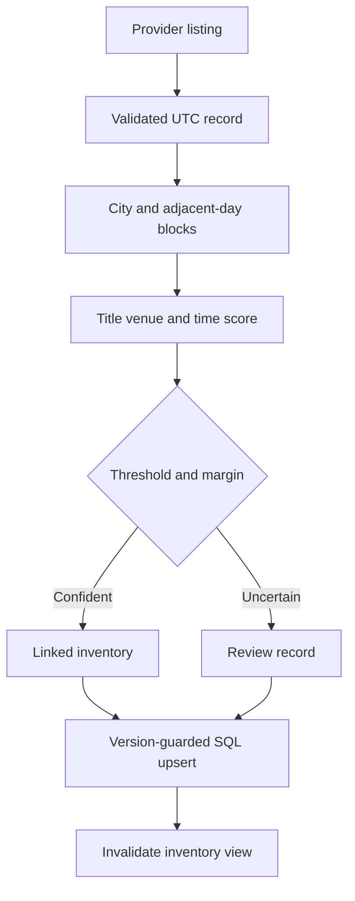

# Architecture and decisions

## Data flow

The canonical catalog is seeded independently from provider variants. Neither matching nor ingestion reads `gold_event_id`; that field belongs only to the evaluation harness. Canonical events are immutable in this version. Listings are mutable source observations identified by `(provider, provider_id)`.

## Matching

1. Normalize Unicode, punctuation, case, generic title words, known city abbreviations, and timezone-aware timestamps. Sports title comparison ignores team order.
2. Retrieve catalog candidates in the normalized city on the observation's UTC day and adjacent days. This preserves near-midnight recall. It does not use the known event ID or split label.
3. Score title token-sort similarity (60%), venue edit similarity (25%), and time agreement (15%). Reject incompatible cities, more than 90 minutes of time drift, title similarity below 0.68, or venue similarity below 0.60.
4. Link only if the highest score clears the configured threshold and its lead over the runner-up clears the configured margin. Otherwise persist the observation for review.
5. Explain the top three candidates, title/venue scores, time difference, threshold, and runner-up margin.

The selected threshold is 0.82 and the margin is 0.06. They were selected on development events from a predefined grid. Weights and feature gates are heuristic design choices, not learned probabilities. A score of 0.9 is **not** a 90% probability of identity.

Complexity is O(N) to build catalog blocks and O(B) comparisons per observation, where B is the local city/day neighborhood. Temporal scoring eliminates candidates from other showtimes. Recall loss from missing titles and large time drift is deliberate and visible in the report.

## Search

A normalized document joins title, venue, and city. Distinct character trigrams map to posting sets; short prefixes use a token index. Query grams select plausible candidates before a field-aware fuzzy ranker scores them. Title comparison is weighted more strongly than venue or whole-document matches.

A bounded LRU caches **only text relevance**, keyed by normalized query. Live prices and quantities, filters, sorting, and pagination are computed on every request. This prevents a popular cached query from freezing an old inventory price. The immutable catalog makes ranking-cache invalidation unnecessary until process restart.

Filters are applied before pagination and without a global pre-filter top-K cutoff. This avoids dropping relevant events in a particular city simply because more popular results elsewhere consumed the shortlist. Tie breaks include timestamp and event ID for stable page boundaries.

## Persistence and concurrency

SQLAlchemy Core supports SQLite for the local demo and PostgreSQL through the psycopg driver. Canonical event payloads are stored as text because this version loads a fixed catalog into an in-memory search model. Listing status, event ID, provider identity, quantity, price, and version are explicit indexed columns.

Provider updates use a single `INSERT ... ON CONFLICT DO UPDATE ... WHERE excluded.updated_at > listings.updated_at` statement inside a transaction. This guards against concurrent retries and out-of-order delivery without a read-then-write race. UTC timestamps use a fixed microsecond ISO format so string ordering is temporal ordering. Equal-time conflicts keep the existing version.

The inventory view aggregates only matched listings with positive quantity. Each successful API write invalidates the read model under a lock. Unavailable events show no active price. Review listings never contribute to customer-visible offers.

A lock coordinates this app's writes with inventory snapshot retrieval. Snapshots are replaced, not mutated, so an in-flight read has a coherent old or new snapshot. A single-worker deployment is required; independent writers and multiple workers need shared versioning or invalidation.

## HTTP and interface

FastAPI owns input constraints, UTC validation, bounded pagination, API schemas, admin authentication, timing middleware, and static frontend delivery. Public preview matching is read-only. Ingestion, review inspection, and process metrics are disabled unless an admin token is configured.

React/TypeScript uses debounced search, abortable requests, explicit loading/error/empty states, native dialogs, keyboard-accessible buttons, local saved-event snapshots, and responsive layouts. Event imagery is CSS artwork rather than external image assets.

## Production extensions

Use a versioned catalog import process, schema migrations, row-level operational audit records, shared search/cache services, distributed tracing, rate limits, feed freshness monitoring, and cancellation/reschedule semantics before treating this as a production system. These are design directions, not implemented claims.
